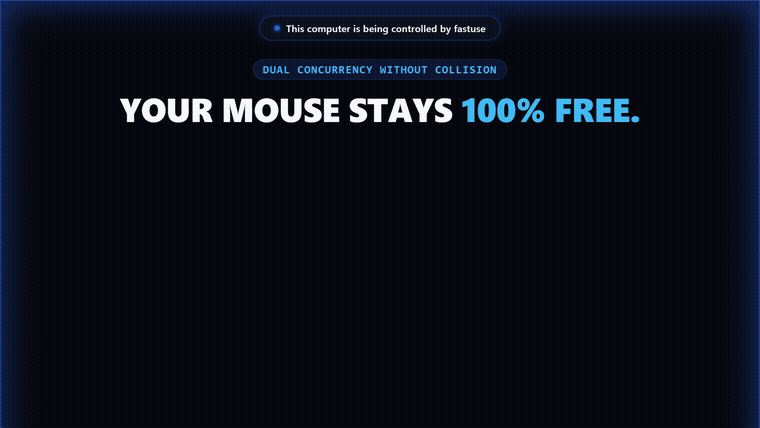

<div align="center">

# ⚡ fastuse

**Ultra-fast, zero-focus-steal Computer Use & Browser Use MCP server for ChatGPT Codex, Claude Code, Cursor, Windsurf, Claude Desktop, Antigravity, Ollama, and local GGUF models.**

[](LICENSE)
[]()
[]()
[]()
[-success.svg)]()

<br>



</div>

---

## ⚡ Why fastuse?

Traditional computer-use tools hijack your real mouse cursor, steal window focus, spin up empty headless browsers without your logins, and burn 4–6 LLM screenshot round-trips per click.

`fastuse` fixes the architecture:

* **Zero Cursor Stealing:** Dispatches clicks, typing, and UI tree reads in the background via native OS APIs (`UI Automation` on Windows, `AXUIElement` + `CoreGraphics` on macOS). Keep working undisturbed while your agent operates windows behind the scenes.
* **Your Real Browser, Logged In:** Connects directly to **Brave, Chrome, or Edge** over a Chrome Native Messaging Host (`fastuse browser-open`), keeping your logins, cookies, and active tabs intact — with an embedded extension inside the single binary.
* **Single-Turn Batches (`act` / `browser_act`):** Executes full sequences (`set_value` + `click` + `wait` + `observe`) in one MCP call (~50ms native execution vs. multi-second screenshot loops).
* **Visible Agent Overlay:** An independent glowing blue cursor and screen-edge aura track every automated action cleanly — while hidden from OS screenshots via `WDA_EXCLUDEFROMCAPTURE`.

---

## 📊 Measured Speed

Tested on Windows 11 (AMD Ryzen 9 / RTX 3070), medians over persistent MCP sessions, compared to [cua-driver](https://github.com/trycua/cua) 0.37.0 (reproducible via `bench/`):

| Operation | Standard Driver (`cua`) | `fastuse` | Speedup |
|---|---|---|---|
| **List windows** | 437 ms | **0.9 ms** | **~485x faster** |
| **Read window UI tree** | 160 ms | **29 ms** | **~5.5x faster** |
| **Click by element** | 16 ms | **1.8 ms** | **~9x faster** |
| **`set_value` (20 chars)** | 16 ms | **2.2 ms** | **~7x faster** |
| **Type 20 chars** | 153 ms | **3.6 ms** | **~42x faster** |
| **Batch flow (`set` + `click` + `observe`)** | *Multiple round-trips* | **~66 ms** | **Single turn** |

---

## 🚀 30-Second Quickstart

### Step 1 — Install `fastuse`

**Windows (PowerShell):**
```powershell
irm https://github.com/anassagd432/fastuse/releases/latest/download/install.ps1 | iex
```

**macOS / Linux (Terminal):** *(requires [Rust](https://rustup.rs) if compiling from source)*
```bash
curl -fsSL https://raw.githubusercontent.com/anassagd432/fastuse/main/install.sh | bash
```

Both installers unpack the binary, add `fastuse` to your `PATH`, extract the browser extension, register native messaging hosts for Chrome/Brave/Edge, and automatically run `fastuse setup` to configure **ChatGPT Codex CLI & Desktop app**, **Claude Code**, **Claude Desktop**, **Cursor**, **Windsurf**, and **Antigravity**.

---

### Step 2 — Or Ask Your AI Agent to Install & Connect It Directly

Paste this into **ChatGPT Codex**, **Claude Code**, **Cursor**, or **Antigravity**:

```markdown
Install and connect `fastuse` for desktop + browser automation:
1. Install via `irm https://github.com/anassagd432/fastuse/releases/latest/download/install.ps1 | iex` (Windows) or `curl -fsSL https://raw.githubusercontent.com/anassagd432/fastuse/main/install.sh | bash` (macOS/Linux) if not already installed.
2. Run `fastuse setup` and `fastuse doctor` so MCP, skills, and browser native messaging are registered for Codex, Claude, Cursor, and Antigravity.
3. For browser tasks: `browser_act` auto-connects a browser; if the user already has Brave/Chrome open with logged-in tabs and the extension isn't attached there yet, use desktop `act` directly on that browser window (UIA/mouse/keyboard) or load `fastuse extension-path` at `chrome://extensions` / `brave://extensions` (`Developer mode` -> `Load unpacked`).
```

Manual MCP setup (if you ever configure a custom client by hand):

<details>
<summary><b>ChatGPT Codex / Claude Code / Cursor / Claude Desktop</b></summary>

Running `fastuse setup` configures all installed clients automatically. For manual registration:

*Codex CLI / Desktop (`~/.codex/config.toml`):*
```toml
[mcp_servers.fastuse]
command = "fastuse"
args = []
```

*Claude Code (CLI):*
```powershell
claude mcp add fastuse -- "$env:LOCALAPPDATA\Programs\fastuse\fastuse.exe"
```

*Cursor / Claude Desktop / Windsurf (`mcpServers` JSON):*
```json
{
  "mcpServers": {
    "fastuse": {
      "command": "fastuse"
    }
  }
}
```
*(Or use the full path `%LOCALAPPDATA%\Programs\fastuse\fastuse.exe` on Windows or `~/.local/bin/fastuse` on macOS.)*

</details>

---

### Step 3 — Launch Your Browser Connected

No manual `chrome://extensions` Developer Mode clicks needed. Run:

```bash
fastuse browser-open
```

* **Browser closed:** Opens Brave/Chrome/Edge directly with the extension attached and all your logins/cookies preserved.
* **Browser already open:** Chromium ignores `--load-extension` on running processes, so `fastuse` launches an isolated automation window immediately — or run `fastuse browser-open --relaunch` to restart your main profile with `--restore-last-session` and keep all logins intact.

Verify everything at any time:
```bash
fastuse doctor
```

Example output:
```text
Windows: UI Automation OK, Per-Monitor v2 HiDPI aware, background input OK, overlay ready (14 visible windows).
Browser use:
  native host manifest: installed (C:\Users\you\AppData\Local\fastuse\com.fastuse.browser.json)
  connected: Brave (host pid file ...)
```

---

## 🛠️ Tool Catalog

### 1. Browser Automation (`browser_act`, `browser_state`)
Operates inside your Chromium browser via the embedded MV3 extension + native messaging bridge:

| Tool | Description |
|---|---|
| `browser_act` | Execute complete web flows in one call (`navigate`, `new_tab`, `switch_tab`, `close_tab`, `back`, `forward`, `reload`, `click`, `double_click`, `right_click`, `hover`, `fill`, `type`, `select`, `press`, `scroll`, `wait`). Supports `observe: false` (zero tree tokens after final step), `diff: true` (delta-only updates), and `filter`. |
| `browser_state` | Reads visible tabs as a compact viewport-prioritized tree (45 rows default, zero coordinates/IDs unless `details: true`). |

```json
{
  "steps": [
    { "tool": "navigate", "url": "https://github.com/anassagd432/fastuse" },
    { "tool": "click", "target": "Issues" },
    { "tool": "fill", "target": "Search", "value": "is:open" },
    { "tool": "press", "key": "Enter" }
  ]
}
```

### 2. Desktop Automation (`act`, `get_window_state`, `list_windows`, `screenshot`)
Operates any Win32, WPF, WinUI, Cocoa, AppKit, or Electron desktop application:

| Tool | Description |
|---|---|
| `act` | Execute an end-to-end desktop batch in one turn (`click`, `double_click`, `right_click`, `set_value`, `type_text`, `press_key`, `hotkey`, `scroll`, `wait`). Supports `observe: false`, `diff: true`, and `filter`. |
| `get_window_state` | Reads an app's UI hierarchy cleanly (`max_elements`, `filter`, `diff`, `details`). |
| `list_windows` | Lists all visible top-level windows with title, PID, process name, and bounds in `< 1 ms`. |
| `screenshot` | Background window capture (`PrintWindow` / `BitBlt`) or desktop capture, cropped and JPEG-encoded (used only as fallback for canvas/media views). |

```json
{
  "window": "Notepad",
  "observe": false,
  "steps": [
    { "tool": "type_text", "text": "Written in the background with zero focus steal.\n" },
    { "tool": "hotkey", "keys": "ctrl+s" }
  ]
}
```

### 3. Local Models — Ollama & GGUF (`delegate`, `fastuse run`)
Stop burning expensive Claude Code, Cursor, or Codex quota on multi-step UI loops. Run UI automation 100% locally at zero token cost via **Ollama** or any local **`.gguf`** model (`llama-server`):

* **MCP Offload (`delegate` tool):** Frontier models call `delegate` once (`~80 tokens`); `fastuse` runs the full UI/browser loop on your local Ollama/GGUF model without sending repo context on every click, returning a single summary line.
* **Standalone CLI:**
```bash
# Inspect local Ollama & llama-server backends
fastuse models

# Auto-detect local Ollama, llama-server, or API key
fastuse run "Open Notepad and type a release checklist"

# Target a specific Ollama model or local .gguf file directly
fastuse run --provider ollama --model qwen2.5:7b "Open github.com in Brave and check issues"
fastuse run --gguf ./models/qwen2.5-7b-instruct-q4_k_m.gguf "Open Calculator and compute 42 * 19"
```

---

## 🔧 Architecture

```text
   ┌─────────────────────────────────────────────────────────────┐
   │        MCP CLIENT (Claude Code / Cursor / Antigravity)      │
   └───────────────┬─────────────────────────────┬───────────────┘
                   │ stdio JSON-RPC              │ stdio JSON-RPC
                   ▼                             ▼
   ┌───────────────────────────────┐ ┌───────────────────────────┐
   │     DESKTOP ENGINE (act)      │ │   BROWSER ENGINE (MV3)    │
   │   Windows: UIA + Win32 Msg    │ │   Brave · Chrome · Edge   │
   │   macOS:   AX + CoreGraphics  │ │   Native Messaging Host   │
   └───────────────┬───────────────┘ └─────────────┬─────────────┘
                   └──────────────┬────────────────┘
                                  ▼
      ┌───────────────────────────────────────────────────────┐
      │   VISUAL OVERLAY (Excluded from screen capture)       │
      │   Independent Brand-Blue Cursor + Edge Glow Aura      │
      └───────────────────────────────────────────────────────┘
```

---

## 🔒 Safety & Privacy

* **Background-First & Focus Isolation:** Operations never steal focus unless `delivery_mode: "foreground"` is requested.
* **Sensitive Site Blocklist:** Built-in refusal prevents automated reading or input on banking, payment, password manager, and credential domains (`paypal.com`, `stripe.com`, `accounts.google.com`, `1password.com`, `bitwarden.com`, etc.).
* **Visual Accountability:** Always shows a translucent edge glow and cursor badge while an agent is interacting with your screen.
* **Capture Privacy:** The overlay uses `WDA_EXCLUDEFROMCAPTURE` so screenshots captured for vision fallbacks stay clean.

---

## 📄 License

MIT License. See [LICENSE](LICENSE) for details.
